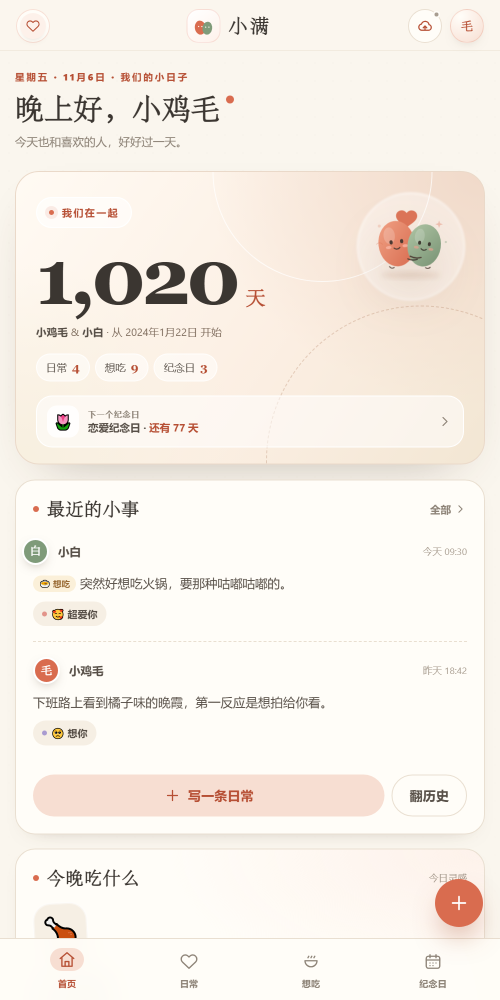
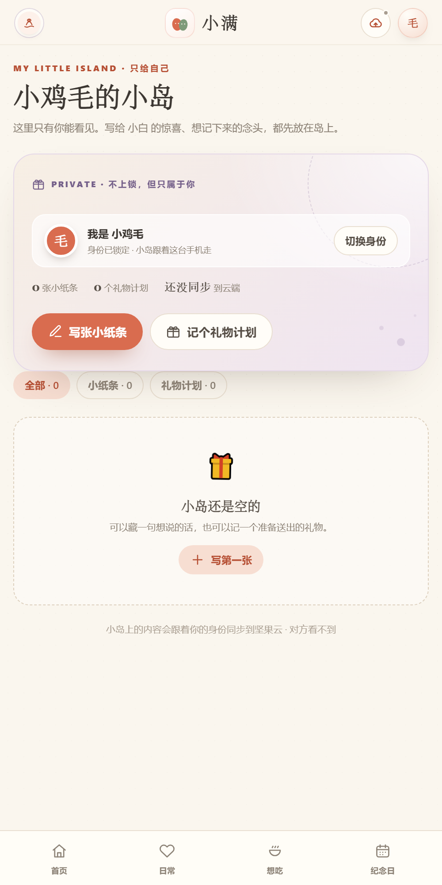
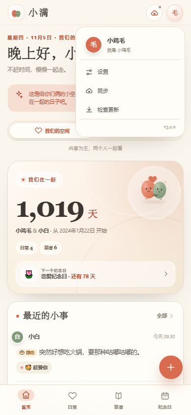
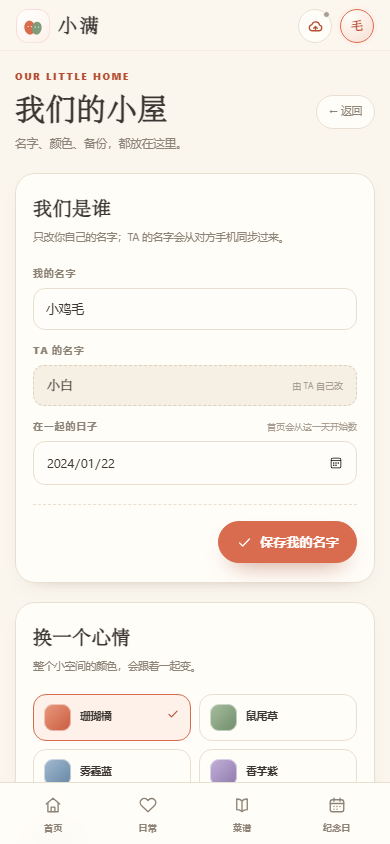
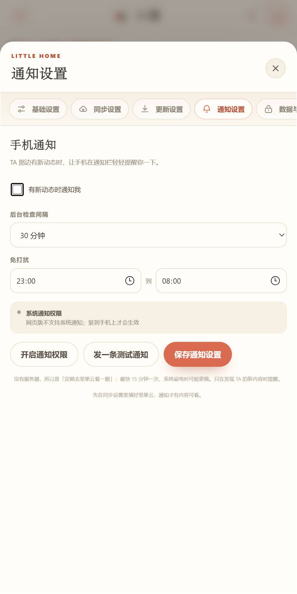
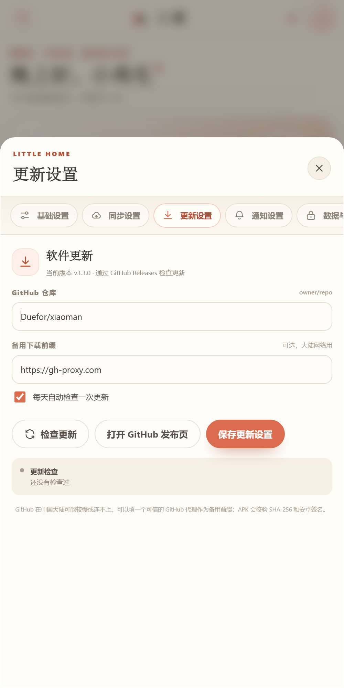

# 小满 · 两个人的小小宇宙

> 一个给两个人用的安卓 App：**共享为主，各自还有一座私人的小岛**。  
> 记录日常、收藏想吃的菜和店、倒数纪念日，也可以把“突然想吃什么”做成一张卡片发给对方。





## 它是什么

小满不是普通的共享账本，而是两个空间：

| 空间 | 用途 | 谁能看到 |
| --- | --- | --- |
| 我们的空间 | 日常、想吃（菜和店）、纪念日 | 两个人都能看 |
| 我的小岛 | 给 TA 的惊喜、礼物计划、只想自己记的事 | 只在“我”的身份下出现 |

左上角的图标可以在「我们的空间」和「我的小岛」之间切换；右上角头像进入设置。

身份在第一次打开时选一次就记住，之后记录小事不用再选。想换身份，去「我的小岛 → 切换身份」，会再确认一次。

两台手机仍然共用**一个坚果云账号**同步，不需要注册两套账号。

> 小岛没有加密，只是和共享空间分开存放、默认不在对方界面显示。  
> 这相当于“分岛，不上锁”：平时不会混，但同一个坚果云账号的人理论上还是能打开文件。

## 功能

- **我们的空间**：日常、照片、心情、想吃清单、纪念日
- **身份锁定**：第一次选完就记住，记录时不再问“谁记录的”；换身份要二次确认
- **拍照**：记录时可以调起相机直接拍，也可以从相册选；照片自动压缩
- **想吃**：分成「想吃的菜」和「想吃的店」两栏
  - 店按场景归类：家附近 / 城里逛逛 / 出去玩 / 其他
  - 可以标「谁想吃」：我 / TA / 都想吃
  - 记店名、城市、位置、想吃的菜、标签、备注、门头照，并一键跳地图
- **日常只留三天**：日常页只显示最近 3 天，更早的去「历史记录」按月翻
- **我的小岛**：小纸条、礼物计划，换手机后按身份从云端恢复
- **悬浮设置**：左侧分栏（基础 / 同步 / 更新 / 通知 / 数据 / 关于），右上角关闭
- **手机通知**：TA 有新动态时在通知栏提醒；检查间隔、免打扰都能自己设
- **照片单独存**：图片放在坚果云 `photos/` 目录，JSON 只存引用，按需下载
- **应用内更新**：检查 GitHub Releases，下载 APK，调用系统安装器
- **主题与动效**：珊瑚橘、鼠尾草、雾霾蓝、香芋紫；动画强度可调「标准 / 轻微 / 关闭」

## 安装

从本仓库的 **Releases** 页面下载最新的 `xiaoman-*.apk`，传到安卓手机安装。

- v3.3.1、v3.3.0、v3.2.0、v3.1、v3.0 使用同一个发布签名，**可以直接覆盖安装，数据保留**。
- 更早的 v2.0 是 debug 签名，不能覆盖，需要先同步/导出，再卸载旧版安装。
- 第一次安装如果提示「未知来源」，允许当前文件管理器安装即可。

> **升级到 3.3 时，两台手机都要升级。**  
> 3.3 起照片不再写进 `shared.json`，旧版读不到新的照片字段；如果一台还停在 3.2，它保存时可能把对方的照片引用冲掉。

更细的安卓说明在 [android-app/README.md](android-app/README.md)。

## 先试用，再发版（预览版）

正式发版前，可以先装一个测试包，用几天确认没 Bug 再打 tag：

1. 把代码推到 `preview` 分支，或在 GitHub Actions 里手动运行「Preview 小满」。
2. 等一两分钟，同一个下载地址会更新：

   ```text
   https://github.com/Duefor/xiaoman/releases/download/preview/xiaoman-preview.apk
   ```

3. 手机上直接下载覆盖安装。测试包和正式版用**同一个签名**，数据保留。
4. 确认没问题后，再打 `v3.3.1` 这样的 tag 正式发布。

预览版是 pre-release：

- 不会出现在「最新版本」里，App 的「检查更新」也不会提示
- 每次构建覆盖同一个 APK，链接不变，方便手机浏览器收藏
- 版本号形如 `3.3.1-preview`，versionCode 和即将发布的正式版一致，正式版可以直接覆盖

## 第一次使用

默认值已经写好：

```text
我的名字：小鸡毛
TA 的名字：小白
在一起：2024-01-22
更新仓库：Duefor/xiaoman
备用下载：https://gh-proxy.com
```

1. 打开 App，先选你是哪一位：**我** 或 **TA**。选完就锁定，之后加号记录会自动用这个身份。
2. 点左上角图标可以去「我的小岛」；点右上角头像 → **设置**，只改你自己的名字和在一起的日子。TA 的名字由对方自己改。
3. 设置 → 同步设置，填坚果云。

### 设置入口

设置现在是悬浮窗，不再占页面。点右上角头像进入，右上角 × 或按 Esc 关闭。  
左侧分栏：基础设置、同步设置、更新设置、通知设置、数据与备份、关于小满。





### 坚果云准备

1. 登录 [坚果云网页版](https://www.jianguoyun.com/)。
2. 右上角头像 → **设置** → **安全**。
3. 添加一个第三方应用，生成**应用密码**（不是登录密码）。
4. 在坚果云「我的文件」根目录新建文件夹 `xiaoman`（`photos/` 子目录第一次同步时会自动建）。

### App 里填

- WebDAV 地址：`https://dav.jianguoyun.com/dav`
- 坚果云账号：登录邮箱
- 应用密码：上一步生成的应用密码
- 云端文件夹：`xiaoman`

点「测试连接」→「保存并同步」。

第二台手机填同一套配置，但选择另一个身份。

## 云端文件

```text
xiaoman/
  shared.json     我们的空间（文字、纪念日、想吃清单）
  me.json         我的小岛
  her.json        TA 的小岛
  photos/         照片（按需下载，不进 JSON）
    <照片ID>.jpg
  sync.json       旧版文件（保留作备份）
```

- 两台手机都同步 `shared.json`
- 每台手机只同步自己身份的 `me.json` 或 `her.json`
- 图片单独放在 `photos/`，JSON 里只保留 ID，所以 `shared.json` 很小
- 旧版 `sync.json` 会合并进 `shared.json`
- 删除会留下标记，另一台同步后也会删除

## 手机通知



小满没有服务器，通知是「定期去坚果云看一眼」实现的：

- 后台最短 15 分钟检查一次，间隔可以在设置里选 15 分钟 / 30 分钟 / 1 小时 / 2 小时 / 6 小时
- 发现 `shared.json` 有更新，才发一条本地通知，不会重复打扰
- 可以设免打扰时段（默认 23:00 到 08:00）
- Android 13 及以上第一次开启时需要允许通知权限
- 系统省电策略下，检查可能比设定时间更晚；这是本地通知的边界，不是 Bug

## 应用内更新



更新流程：

```text
启动 App / 点「检查更新」
        ↓
请求 GitHub Release 的 latest.json
        ↓
发现 versionCode 更大
        ↓
弹窗显示版本说明
        ↓
下载 APK 并校验 SHA-256
        ↓
打开 Android 系统安装器
        ↓
覆盖安装，数据保留
```

说明：

- Android 普通 App **不能静默安装**，最后一定会弹系统安装确认；点一下确认即可。
- 第一次使用会跳「安装未知应用」权限，允许后回来再点一次安装。
- 更新必须使用同一个签名文件；当前签名在 `android-app/keystore/xiaoman-release.jks`，不要丢。
- `versionCode` 必须递增；仓库的 tag 使用 `v3.3.1` 这种格式，Actions 会自动算。

### 在中国大陆使用 GitHub

GitHub 有时会慢或连不上。App 的设置里有一个「备用下载前缀」：

```text
https://gh-proxy.com/
```

这是第三方 GitHub 代理，只作为备用；APK 会校验 SHA-256，Android 还会校验签名。  
如果你有自己稳定的代理/镜像，也可以填自己的。

不填备用前缀时，App 直接访问 GitHub；检查失败会提示，不会影响坚果云同步。

## 把代码放到 GitHub

### 1. 创建公开仓库

新建一个 **public** 仓库，比如 `xiaoman`，然后把当前目录推上去。

不要提交：

- `android-app/keystore/` 里的签名文件
- `node_modules`
- 构建目录
- APK

仓库里的 `.gitignore` 已经处理了这些。

### 2. 添加 GitHub Actions Secrets

在仓库 **Settings → Secrets and variables → Actions** 添加：

| Secret | 内容 |
| --- | --- |
| `ANDROID_KEYSTORE_BASE64` | `xiaoman-release.jks` 的 base64 |
| `XIAOMAN_STORE_PASSWORD` | keystore 密码 |
| `XIAOMAN_KEY_ALIAS` | `xiaoman` |
| `XIAOMAN_KEY_PASSWORD` | key 密码 |

PowerShell 生成 base64：

```powershell
[Convert]::ToBase64String(
  [IO.File]::ReadAllBytes("android-app/keystore/xiaoman-release.jks")
) | Set-Clipboard
```

### 3. 发布一个版本

```bash
git tag v3.3.1
git push origin v3.3.1
```

GitHub Actions 会：

1. 安装依赖
2. 同步 Capacitor 资源
3. 用 Secrets 里的 keystore 签名
4. 生成 `xiaoman-v3.3.1.apk`
5. 生成 `latest.json`（包含版本号、APK 地址、SHA-256）
6. 创建 GitHub Release

### 4. 让 App 知道仓库

打开 App → 右上角头像 →「设置 → 更新设置」：

- GitHub 仓库：`你的用户名/xiaoman`
- 备用下载前缀：可选

保存后点「检查更新」。以后每次启动，App 最多每天自动检查一次。

## 项目结构

```text
.
├── android-app/
│   ├── www/                 # H5 源码：index.html / styles.css / motion.css / app.js
│   ├── android/             # Capacitor 安卓工程
│   │   └── app/src/main/java/com/xiaoman/couple/
│   │       ├── MainActivity.java
│   │       ├── AppUpdaterPlugin.java      # 应用内更新
│   │       ├── XiaomanCameraPlugin.java   # 直接拍照
│   │       ├── XiaomanMediaPlugin.java    # 照片存储 + 坚果云 photos/
│   │       ├── XiaomanNotifyPlugin.java   # 通知权限 / 通知 / 后台检查配置
│   │       └── XiaomanSyncWorker.java     # WorkManager 定时检查
│   ├── assets/              # 图标源文件
│   ├── keystore/            # 本地签名文件（不提交）
│   └── README.md            # 安卓版详细说明
├── .github/workflows/
│   └── release.yml          # tag 自动打包 + 发布
├── .gitignore
├── RELEASE_NOTES.md         # 每次发版前改这里
└── preview-*.png            # 界面预览
```

## 本地构建

需要 JDK 21、Android SDK 35、Node.js 和 pnpm。

```powershell
cd android-app
pnpm install
pnpm exec cap sync android
cd android
.\gradlew.bat assembleRelease
```

首次构建前创建 `android/local.properties`：

```properties
sdk.dir=C:/Android/Sdk
```

APK 在：

```text
android/app/build/outputs/apk/release/app-release.apk
```

## 隐私与边界

- 日常数据默认在本机；开启同步后写到你们自己的坚果云。
- 同步使用一个坚果云账号 + 应用密码；应用密码只保存在本机。
- 照片不写在 JSON 里，单独存在 `photos/`；本机有一份缓存，没缓存时按需下载。
- 小岛不加密，只做界面和文件隔离。
- 通知不是实时推送：靠后台定期检查，最快 15 分钟，系统省电时会更晚。
- 换手机/卸载前，建议在「设置 → 数据与备份 → 导出数据」备份（备份文件包含照片）。

## 之后可以继续加

- 小岛加密
- 更好的地图定位（直接读取当前城市）
- 更完整的 Release 说明和自动版本号
- 桌面小组件
